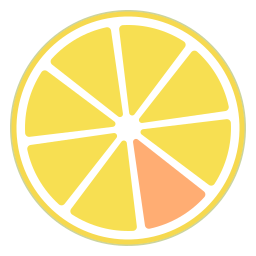

# CHAR · 字形转换



用于 Halo 的完整字形转换插件，包含公开转换页面、字库及超级管理员后台管理。基于 [yukiyuqichen/CHAR](https://github.com/yukiyuqichen/CHAR)，保留并维护 RoShioLeo 的字形修正。

[在线使用](https://www.lemonslice.cloud/tools/char/) · [下载插件](https://github.com/RoShioLeo/CHAR/releases) · [维护说明](docs/MAINTENANCE.md) · [上游项目](https://github.com/yukiyuqichen/CHAR)

## 功能

- 异体字转简体、繁体；支持「默认转换」和「多字候选」。
- 文本转换、结果复制、UTF-8 文本文件转换与下载。
- 中文界面，外观和交互与 LemonSlice 博客及私厨统一；支持浅色、深色、跟随系统。
- 超级管理员可在 Halo 后台检索、新增、编辑、多选停用和恢复映射，导出字库与修正，查看修改记录。
- 原字和候选字均显示字形与 Unicode 编码；新增原字、编辑候选和检索支持十六进制码输入。
- 字形修正与发布包中的基础字库独立保存，升级时保留后台修改。

## 安装和入口

面向 **Halo 2.26.0 及以上版本**开发，已在 Halo 2.27.2 上验证。

1. 从 [Releases](https://github.com/RoShioLeo/CHAR/releases) 下载 `LemonSlice-CHAR-*.jar`。
2. 在 Halo 后台的插件管理中安装并启用。
3. 前台地址为 `/tools/char/`，后台入口为 **工具 → 字库管理**，也可直接访问 `/console/char-dictionary`。

前台可公开使用。字库管理的界面入口和管理 API 均限制为具有 `super-role` 的超级管理员；超级管理员访问前台时，右上角会显示「字库管理」。

安装包已包含转换页面、脚本、图标和字库，安装插件即可使用。

## 字库编辑

候选字按行填写，第一行用于「默认转换」，多个候选在「多字候选」下展开。可输入实际字符，也可使用以下形式：

| 输入 | 字形 | Unicode |
| --- | --- | --- |
| `一`、`U+4E00`、`0x4E00`、`4E00` | 一 | U+4E00 |
| `𠀀`、`U+20000`、`0x20000`、`20000` | 𠀀 | U+20000 |

「停用」会使转换保留原字；「恢复」会删除该字的后台修正，重新使用插件基础字库。保存时校验资源版本，如其他操作已经改动字库，须刷新后重新确认。

可以逐行勾选或全选当前页后批量停用。批量操作一次保存、统一校验版本，出现冲突时不会只应用一部分；停用时保留已有候选和备注。

两份字库的后台修正分别保存在 Halo 的 `lemonslice-char-v2s`、`lemonslice-char-v2t` ConfigMap 中，包含候选、停用状态、备注、操作人和修改记录。前台只读取合并后的映射。

## 上游同步与已有修正

2026-11-26 同步至上游提交 [`64b2707`](https://github.com/yukiyuqichen/CHAR/commit/64b27076638255e8293827e04f81c070855edfad)。

两份字库各保留 **27 项自定义修正**。冲突项「壹、拾、柒」按维护者确认保留原字，其他上游更新按字形逐项合入。`test/fork-overrides.json` 记录这些修正，并由 JavaScript、Python 和插件测试保护。

后续字库冲突须比较共同基线、本分支和上游，确认后再处理。详细过程见 [维护说明](docs/MAINTENANCE.md)。

## 开发和构建

- 前台：根目录 `index.html`、`styles.css`、`app.js`、`appearance.js`、`charConverter.js`。
- 基础字库：`char_converter/data/v2s.json`、`v2t.json`。
- Halo 插件及后台：`halo-plugin/`。
- 上游 Python 转换器和 npm 包源码继续保留，便于同步与复用。

使用 Java 21、Node.js 24 构建：

```bash
./halo-plugin/gradlew -p halo-plugin clean build
```

Windows 可在 `halo-plugin` 目录执行 `gradlew.bat build`。安装包输出到 `halo-plugin/build/libs/`。

字库与 Unicode 输入检查：

```bash
python -m unittest discover -s test -p 'test_*.py'
node --experimental-strip-types --test test/*.test.cjs
```

`checks.yml` 在推送和 PR 时执行检查并构建插件；手动运行时填写 `releaseVersion` 可发布安装包。原 GitHub Pages 工作流只保留手动备用发布。

## 来源和许可

原 CHAR 项目由 **Yuqi Chen** 开发，贡献者包括 **Hongsu Wang、Yiyi Wang、Fengyi Ji、Kaini Xiong**。数据来源包括 [CBDB](https://projects.iq.harvard.edu/cbdb)、[OpenCC](https://github.com/BYVoid/OpenCC)、[异体字字典](https://dict.variants.moe.edu.tw/)及《通用规范汉字表》，详见上游项目。

- CHAR 字库及转换器保留 [CC BY-SA 4.0](LICENSE)。
- 独立编写的 Halo 集成和新增前台 UI 采用 [MIT](LICENSE-MIT)，保留版权与许可声明。
- Halo 运行环境和宿主 UI 组件保留其 GPL-3.0 等原有许可；MIT 声明不免除组合分发时的第三方义务。
- 安装包包含两份许可、[许可范围](LICENSES.md)、[署名说明](NOTICE.md)和 [第三方声明](THIRD_PARTY_NOTICES.md)。CHAR 的 CC BY-SA 4.0 仍包含相同方式共享要求，整个项目不宣称仅需署名。
